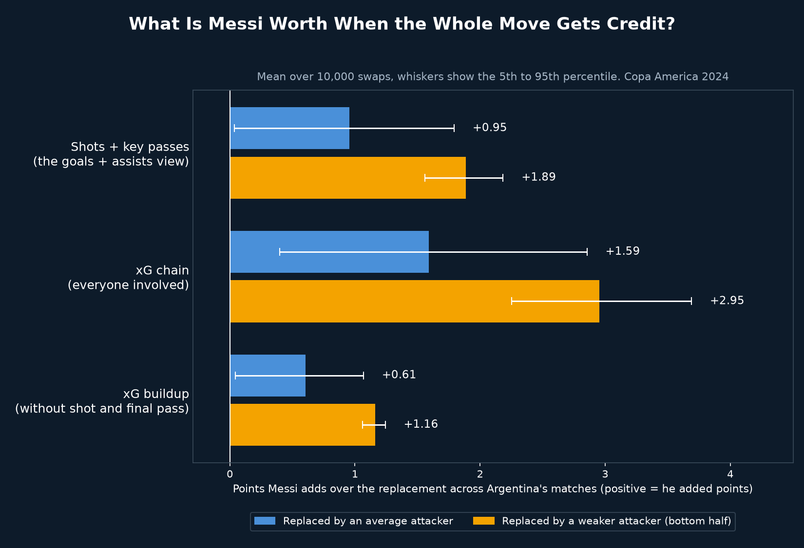
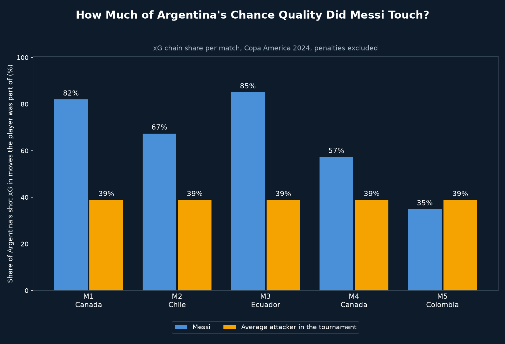

# Messi Valuation with Chain Credit

## Why
An earlier project valued Messi by swapping his goals and assists for a replacement player's, and found almost nothing (16 actual points vs 16.7 simulated), because he scored or assisted in only 2 of 6 matches. This project redoes the swap with shared credit: how much of Argentina's chance quality was Messi part of, and what changes if an average attacker is part of it instead?

## What it does
- Takes Argentina's non-penalty shot xG in each match Messi played (5 matches, he missed the Peru game)
- Measures Messi's share of that xG under three credit views: shots + key passes (the goals + assists view, in xG), xG chain, and xG buildup
- Replaces his share with one drawn at random from attackers in the tournament (226 attacker-matches, 86 players, at least 40 touches each, zeros kept)
- Turns the adjusted xG into expected points with Poisson goals, 10,000 swaps per measure
- Runs a second, weaker replacement pool (bottom half of attackers) as a check

## Key findings

| Credit view | Value vs average attacker | 5th to 95th percentile | Runs above 0 | Weaker attacker (upper bound) |
|---|---|---|---|---|
| Shots + key passes | +0.95 | +0.04 to +1.79 | 96% | +1.89 |
| xG chain | +1.59 | +0.40 to +2.86 | 99% | +2.95 |
| xG buildup | +0.61 | +0.04 to +1.07 | 96% | +1.16 |

| Match | Messi share of xG | Average attacker | Expected points with / without Messi | Value |
|---|---|---|---|---|
| 1. Canada | 82% | 39% | 2.62 / 1.94 | +0.68 |
| 2. Chile | 67% | 39% | 2.82 / 2.55 | +0.27 |
| 3. Ecuador | 85% | 39% | 1.54 / 1.12 | +0.42 |
| 4. Canada | 57% | 39% | 2.10 / 1.85 | +0.25 |
| 5. Colombia | 35% | 39% | 1.43 / 1.46 | -0.03 |

- Messi was part of 35% to 85% of Argentina's shot xG per match, against 39% for an average attacker
- xG chain puts his value at +1.59 points over the 5 matches, about 1.7x the shots + key passes view (+0.95)
- The xG version of goals + assists is not near zero, so the earlier near-zero result came mostly from counting only finished goals and assists, not only from missing the buildup
- In the Colombia match he was part of less xG than an average attacker, so the swap changes nothing (-0.03). He was substituted in that final, which is a likely reason but is not tested here
- xG from the matches alone gives 10.51 expected points against 13 real points

## Limitations
- The model assumes the moves Messi was part of would not happen without him, so the values are an upper bound
- The weaker-pool results (+2.95 for chain) are higher still, because the bottom half of the pool has very low shares
- Touches stand in for minutes played (no lineup data), so substitutes are mostly kept out of the pool
- Every touch counts equally, and defending and off-ball movement are not credited
- Five matches is a small sample, and expected points come from xG, so they do not match real points

## Visual

*Points Messi adds over the replacement under each credit view. Whiskers show the 5th to 95th percentile.*

*Share of Argentina's shot xG in moves Messi was part of, against the average attacker.*

`messi_swap_replay.mp4` shows the swap match by match: Messi's part is removed, a replacement is added, and the expected points are recomputed. The two charts are included at the end of the video.

## Tools
Python, pandas, NumPy, matplotlib, imageio-ffmpeg, statsbombpy

## Data source
StatsBomb open data, Copa America 2024 (32 matches). Penalties excluded, shootouts excluded.
